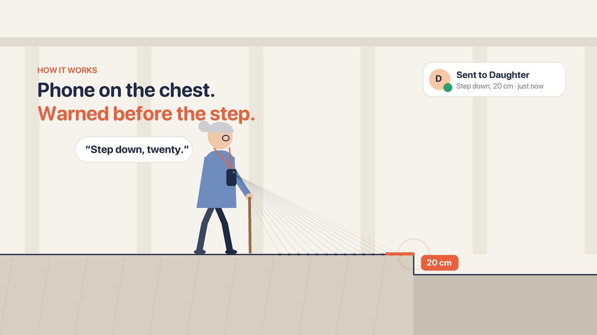
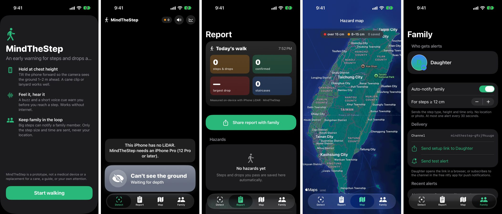

# MindTheStep


**Warned before the step, not after the fall.**

MindTheStep turns a LiDAR iPhone, worn on the chest or clipped to a cane, into an early warning for older adults. It sees steps, curbs and stairs 0.3–2.5 m ahead and warns with a buzz, a short voice cue and a red frame before the person gets there. Big steps also send a real-time alert to a family member, and every walk ends with a report, a hazard map and a short note for the family written by Apple's on-device AI.

Built in one evening at **c0mpiled-18 (YC Startup School Hackathon, Taipei, 2026-11-11)** for YC's Request for Startups: **AI for the Aging Population**.



**▶ Demo video (1:50):** https://youtu.be/XT80odwnBWA

---

## Why

Falls are the second leading cause of unintentional injury death worldwide, and adults over 60 suffer the most fatal falls ([WHO](https://www.who.int/news-room/fact-sheets/detail/falls)). In Taiwan's arcades every storefront sets its own floor height, so a walk to the market can mean dozens of unmarked steps and curbs.

Most products for older adults react after a fall. MindTheStep tries to warn before one.

## What it does

| | |
|---|---|
| **Live step detection** | LiDAR depth, 60 fps, on-device. Detects step up, step down, stairs and ramps, measured in centimetres. |
| **Felt and heard** | Haptic pulse first (zero latency), then a short voice cue ("Step down, twenty"). Thick pulsing red frame and an AR line drawn on the real edge. |
| **No crying wolf** | Gentle ramps are shown, not alerted. Chairs, bags, people and walls are rejected. If it can't see the ground, it says so instead of guessing. |
| **Family alert** | Steps over a threshold send a real push notification to a family member (via ntfy.sh). Only the step type, height and time are sent. |
| **Hazard memory** | Every confirmed step is saved with time, height, GPS and a photo. Swipe to confirm or mark as a false alarm. |
| **Tape-measure check** | Enter the real height measured with a tape; the report shows the LiDAR error. |
| **Report and map** | Walk summary (steps, largest drop, staircases) shareable with family, plus a map of every hazard. |
| **AI note for family** | Apple Intelligence (FoundationModels, on-device) turns the walk log into a short, warm note for the family. Only logged facts go in; false alarms are excluded; nothing is uploaded. |



Four tabs: **Detect · Report · Map · Family**, plus a first-launch guide.

## How detection works

```
ARKit sceneDepth (256×192, single frame, high-confidence points only)
  → unproject with camera intrinsics → gravity-aligned world points
  → keep a 50 cm corridor 0.3–2.5 m ahead of the walking direction
  → ground reference from the nearest visible ground (reject if it is < 0.7 m below the phone: a seat or table)
  → 5 cm bins: drop points far above ground and bins with a wide height spread (vertical faces)
  → find the nearest abrupt height jump ≥ 8 cm between two flat surfaces
      steps > 25 cm up / 35 cm down  → "obstacle", soft warning, not logged
      two riser-sized steps in a row → stairs
      gradual change                 → ramp (no alert)
      ground ends early              → UNKNOWN (never treated as safe)
  → confirm in 3 of 5 frames, 3 s cooldown → haptic + voice + red frame + AR edge marker
```

- Processing: about 1–8 ms per frame on iPhone 17 Pro; alert latency about 40–50 ms from depth frame to haptic.
- The detector (`StepDetector.swift`) is pure Swift with no ARKit dependency, so it is fully unit-tested.

## Built from field tests

Every fix below came from walking real streets and stairs tonight, then writing a test that reproduces it:

| Field test | Problem | Fix |
|---|---|---|
| 1 · stairs up | Worked: 18–20 cm detected | — |
| 2 · stairs down | The wall at the foot of the stairs read as a false "step up" | Reject bins with a wide height spread; require flat surfaces on both sides |
| 3 · cluttered room | Chair seats read as "stairs down 43 cm" | Height caps, phone-height sanity check, stricter stairs rule |
| 4 · standing still | Red frame kept flashing on "can't see ground" | Only real steps trigger the red frame; usage states stay quiet |

19 unit tests cover drops, step-ups, occluded curbs, ramps, walls, chair seats, bags, stairs, the tracker, and the facts given to the AI.

## Built tonight: the commit log

From empty repo to working app in under four hours, every step tested on a real street:

```text
19:05  feat  real-time LiDAR step detector, haptic + voice alerts
19:16  fix   wall at the foot of the stairs read as a step up      ← field test 2
19:20  feat  senior-first UI, AR line on the real edge
19:27  feat  hazard memory, tape-measure check, family summary
19:35  fix   chairs, bags and people no longer read as stairs      ← field test 3
19:40  feat  red alert frame + real push alerts to family
19:47  fix   red frame only for real steps                         ← field test 4
19:53  feat  four-tab app, onboarding, family alert log, icon
20:55  feat  caregiver note written by on-device Apple Intelligence
```

## Privacy

- Detection runs entirely on the phone. No internet needed to warn.
- Family alerts contain only the step type, height and time.
- Location and photos stay on the phone unless the user shares a report.
- The AI note is written on-device by Apple's model.

## Run it

Requires Xcode 26+ and an iPhone with LiDAR (12 Pro or later). Apple Intelligence is needed for the AI note; otherwise a standard summary is shown.

```bash
brew install xcodegen
xcodegen generate
open MindTheStep.xcodeproj   # set your team, run on device
```

Tests (simulator):

```bash
xcodebuild test -project MindTheStep.xcodeproj -scheme MindTheStep \
  -destination 'platform=iOS Simulator,name=iPhone 17 Pro'
```

## Code map

| File | Role |
|---|---|
| `StepDetector.swift` | Pure geometry: step / stairs / ramp / unknown detection and the frame tracker |
| `DepthProcessor.swift` | ARKit depth → gravity-aligned ground samples |
| `AppModel.swift` | AR session, detection loop, AR edge marker, hazard logging, family alerts |
| `AlertPlayer.swift` | Haptics and voice |
| `ContentView.swift` | Tab shell, live Detect screen, onboarding, alert animation |
| `HazardViews.swift` | Report, Map and Family tabs |
| `HazardStore.swift` | Hazard log (JSON + photos), walk summary |
| `AISummary.swift` | On-device Apple Intelligence note for family |
| `FamilyNotifier.swift` | Push alerts, family settings, alert log |

## Known limits

- Descending stairs are confirmed late (about 0.6–1.1 m), because lower treads are hidden behind the top step.
- Not validated on glossy floors, in strong sunlight, or for drops under 8 cm.
- The ntfy channel is a random public topic; a production version needs private, encrypted push.

## Next

- Map-based early warning: warn near a known hazard before the camera sees it.
- Opt-in location sharing for emergencies.
- Validation with older adults and caregivers.

## Status

Hackathon prototype. **Not a medical device or a validated mobility aid.** Do not rely on it for independent navigation.
